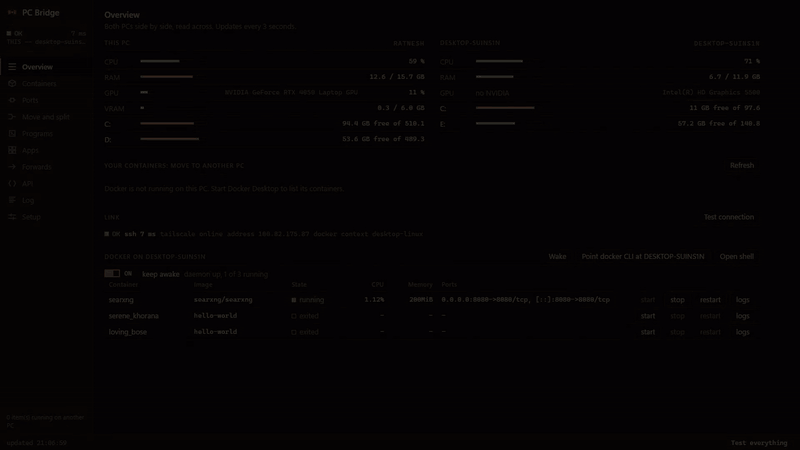
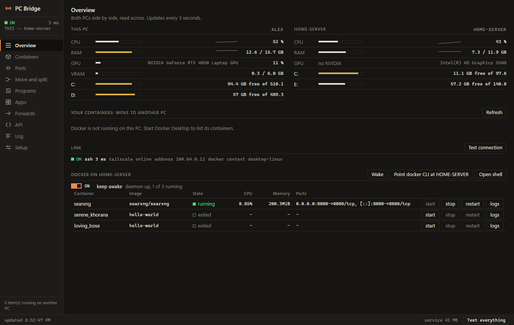
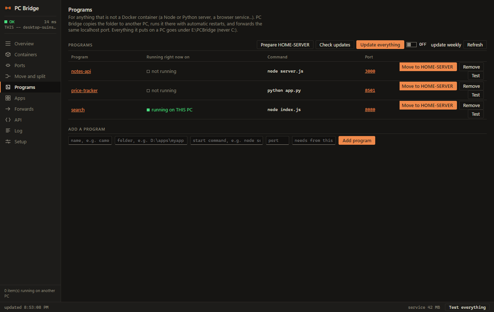
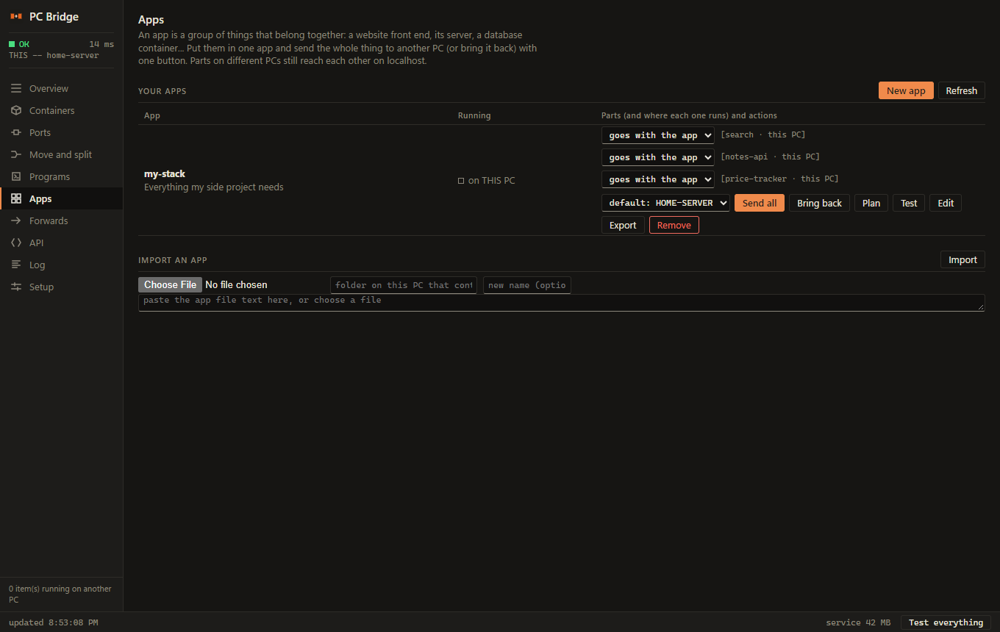
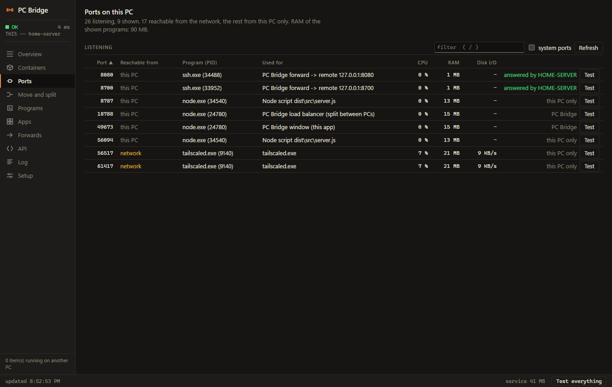
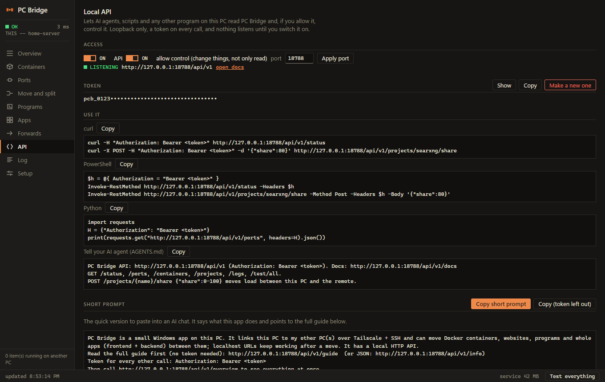
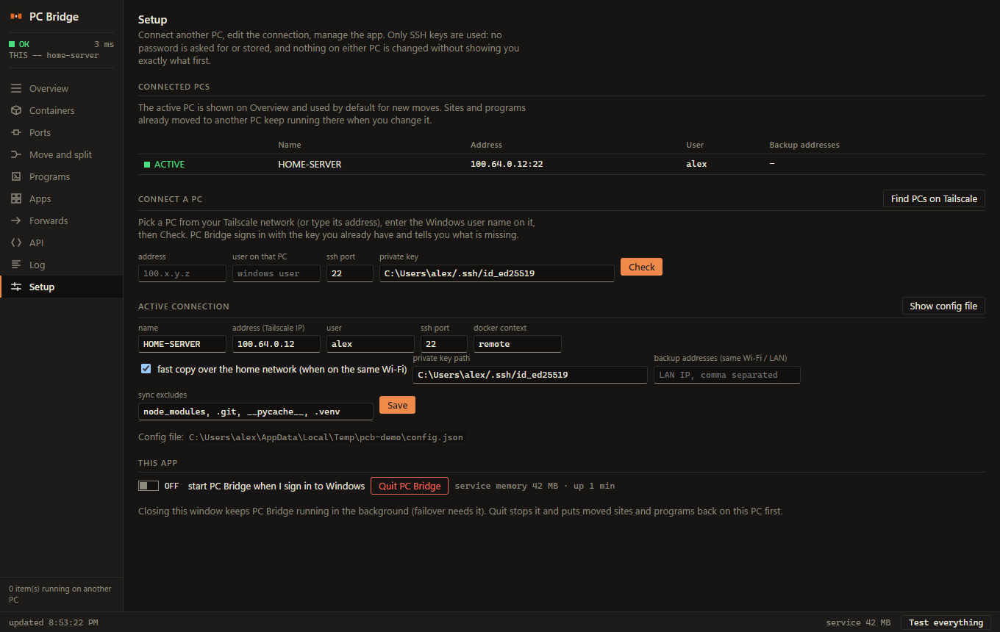

<div align="center">

# PC Bridge

**Turn two Windows PCs into one. Move Docker containers and Node / Python programs to your other PC, keep `localhost` working, and bring everything back with one click.**

Tailscale + SSH keys &nbsp;·&nbsp; no Electron &nbsp;·&nbsp; ~45 MB of RAM &nbsp;·&nbsp; nothing exposed to the internet

   



[Demo video (mp4)](docs/demo.mp4) · [Full guide](docs/GUIDE.md) · [Report a problem](https://github.com/ratneshdagli/PcBridge/issues)

</div>

---

## Why

You have a laptop and a second PC (a desktop, a home server, an old machine with free RAM and a big disk). Heavy things such as a local search engine, a scraper, a Python data service or a side project keep eating your laptop. PC Bridge moves them to the other PC **without changing a single URL**: `http://localhost:8080` on the laptop keeps answering, it just goes through a tunnel to where the program now runs. If the other PC dies, it fails over to the laptop.

## Features

| | |
|---|---|
| **Live overview** | CPU, RAM, GPU, VRAM and every drive of **both** PCs side by side, link state, remote Docker containers. |
| **Move Docker containers** | Copies the container's config and data to the other PC, stops it here, forwards the port back. Split traffic **80/20, 50/50, ...** between both PCs. |
| **Move programs** | Any Node or Python program (a folder + a start command + a port): copied over, dependencies installed there (portable Node, `uv` + private venv), run under a restarting supervisor. |
| **Apps** | Group programs and containers into one app and **Send all** / **Bring back** in order. All-or-nothing with automatic rollback. Parts on different PCs still reach each other on `localhost`. |
| **Fast copies** | On the same Wi-Fi, big copies use the LAN address instead of Tailscale: **43 MB/s instead of 2.5 MB/s** (37 GB in about 15 minutes instead of 4 hours). |
| **Failover** | The other PC stops answering for 3 polls and the program starts on your PC again. |
| **Safe quit** | Close PC Bridge and things stay on the other PC for 10 minutes. Open it again to keep them there, otherwise they come back. |
| **Push changes** | Edited a file? Send just that file to the program running on the other PC, no new copy, no restart. |
| **Everything clickable** | Every port you see (containers, programs, apps, forwards, ports) opens `http://localhost:PORT` in one click, and you can save extra pages such as `/docs/try.html` per program. **Apps > All addresses** lists every link in one place (also `GET /api/v1/links`). |
| **Global envs** | One tab that finds every `.env` file on this PC (all drives) and in your other PCs' PC Bridge folder, grouped by folder name. Search by variable, values hidden until clicked, copy a value, a line or a whole file, open the folder. Nothing is saved and the API never serves them. |
| **Quiet hours** | Set a daily window (for example 09:00-15:00) for a slow other PC: PC Bridge then checks it every 20 s instead of every 3 s, skips the GPU and Docker-stats queries, and runs the programs it started there at low CPU priority. Off by default, in Setup. |
| **Ports** | Every listening port on this PC, who owns it, what it is for, whether the network can reach it. |
| **Local API** | Loopback-only HTTP API with a token (off by default) so scripts and AI agents can read and control everything. OpenAPI + a built-in guide. |
| **Test buttons everywhere** | One click runs every self test and tells you exactly what is wrong. |

## Screenshots

<table>
<tr>
<td width="50%"><b>Overview</b><br></td>
<td width="50%"><b>Programs</b><br></td>
</tr>
<tr>
<td><b>Apps: Send all / Bring back</b><br></td>
<td><b>Ports</b><br></td>
</tr>
<tr>
<td><b>Local API</b><br></td>
<td><b>Setup: connect a PC</b><br></td>
</tr>
</table>

## Quick start

**You need**
- Two Windows 10/11 PCs, both on the same [Tailscale](https://tailscale.com/) network
- [Node.js 18+](https://nodejs.org/) on the PC that runs PC Bridge (your main PC)
- The OpenSSH client (built into Windows) and **OpenSSH Server running on the other PC**
- Optional: Docker Desktop on the PCs if you want to move containers

**1. Let this PC log in to the other PC with a key** (PC Bridge never asks for or stores passwords, and never edits `authorized_keys`, sshd, firewall rules, SSH keys or Tailscale):

```powershell
ssh-keygen -t ed25519                       # on this PC, press Enter for the defaults
type $env:USERPROFILE\.ssh\id_ed25519.pub   # copy this line
# on the OTHER PC, put that line into:
#   %USERPROFILE%\.ssh\authorized_keys                  (normal user)
#   C:\ProgramData\ssh\administrators_authorized_keys   (if that user is an administrator)
```

**2. Run PC Bridge**

```bash
git clone https://github.com/ratneshdagli/PcBridge.git
cd PcBridge
npm install
npm start          # builds and opens the window (your Edge/Chrome in app mode)
```

Next time, double-click `PC-Bridge.vbs` (no console window).

**3. Connect your other PC.** Open **Setup**, press *Find PCs on Tailscale*, pick the PC, type its Windows user name and press **Check**. PC Bridge tells you step by step what works (key login, WSL, Docker) and what is missing. When it is green, press **Add and switch**.

**4. Move something.** Open **Programs**, add a program (name, folder, start command, port), press **Prepare other PC** once, then **Move to PC**. Open `http://localhost:<port>`: it is now served by the other PC.

> Everything PC Bridge puts on the other PC lives in **one folder** (default `E:\PCBridge`, never on `C:`): portable Node, your program folders, logs. No installer, no service, no registry, no admin rights. Delete the folder and it is gone.

## How it works

```
 your PC                                        other PC
┌──────────────────────────┐   Tailscale     ┌──────────────────────────────┐
│ browser / tools          │   + SSH keys    │ E:\PCBridge\apps\myapp       │
│   http://localhost:3000 ─┼── ssh -L 3000 ──┼─▶ node server.js  :3000      │
│ PC Bridge (Node, 45 MB)  │                 │ supervisor restarts it       │
│   UI on 127.0.0.1 only   │◀── status ──────┤ Docker (WSL) containers      │
└──────────────────────────┘   LAN: 43 MB/s  └──────────────────────────────┘
```

PC Bridge is one small Node process. It serves its UI on `127.0.0.1` and opens it in the Edge/Chrome you already have (`--app` window), so there is no Electron and no bundled browser. It shells out to the system `ssh`, `docker`, `tailscale`, `tar` and `wsl`, and every command it runs is shown in the **Log** screen.

## Security

- Service and API listen on **127.0.0.1 only**. Nothing is exposed to the network or the internet.
- Key based SSH only. No passwords are asked for, stored or sent.
- The UI uses a per-run random token (HttpOnly, SameSite=Strict cookie) plus Host/Origin checks and a strict CSP. All text from the other PC is inserted as plain text.
- The local API is **off by default**; *write* access is a second, separate switch. Constant-time token compare, Host header check (DNS rebinding), no CORS.
- Host names, user names, container names and addresses are validated before they get anywhere near a command line.
- The only change PC Bridge can make to the other PC outside its own folder is creating a `docker.cmd` shim, and it shows you the exact content first.

## Documentation

- **[docs/GUIDE.md](docs/GUIDE.md)**: every screen, load splitting, programs and their options (`python`, `requirements`, `needs`, `pullExcludes`, ...), apps, the local API, fast copies, troubleshooting.
- A running copy documents its own API: `http://127.0.0.1:8787/api/v1/docs` (HTML), `/openapi.json`, and `/guide` (plain text written for AI agents).

## Development

```bash
npm install
npm run build      # tsc -> dist/
npm start          # build + run
npm test           # end-to-end tests against a REAL second PC, see docs/GUIDE.md
```

Source layout: `src/core.ts` (ssh/docker/tailscale, routes, offload, failover) · `src/programs.ts` (programs, supervisor, copies) · `src/apps.ts` · `src/balancer.ts` (weighted TCP proxy) · `src/setup.ts` (wizard) · `src/publicapi.ts` (local API) · `src/server.ts` (service) · `renderer/` (UI, plain JS/CSS, no framework, no build step).

## Troubleshooting

| Symptom | Fix |
|---|---|
| Overview is red / DOWN | It tells you why (Tailscale offline, ssh refused, key rejected) and gives a checklist. |
| "key was rejected" | **Setup → Check** shows the exact public key and where it belongs on that PC. |
| `docker: not recognized` on the other PC | **Setup → Check →** create `docker.cmd` (shown in full first). |
| Copies are slow | Make sure both PCs are on the same network and *fast copy over the home network* is ticked in Setup. Install Git for Windows (its `ssh` is much faster than the one built into Windows for big copies). |
| API answers 401 / 403 | Wrong token, or *Allow control* is off (API screen). |

## License

[MIT](LICENSE) © Ratnesh Dagli
